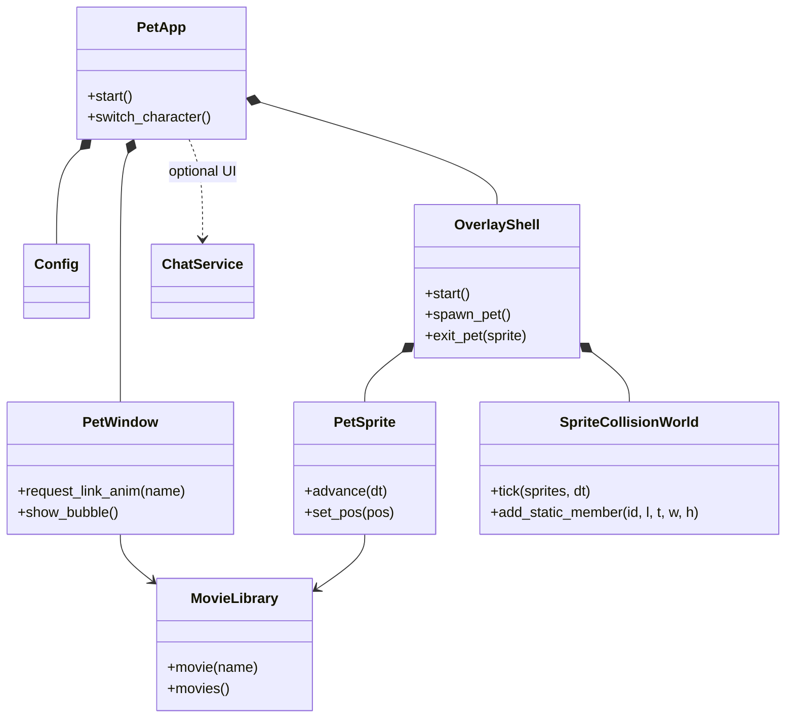

# Engineering guide

## Project shape

This is a PySide6 desktop-pet application. `python -m pet` enters through
`pet/__main__.py`; `PetApp` owns application-level services, `PetWindow` owns
interactive pet behavior, and `MovieLibrary` owns animation media. Keep Qt
objects on their owning thread and communicate across threads with queued
signals.

**Two render topologies, one process.** `PET_RENDER_TOPOLOGY=overlay` (dev env
flag, read only in `pet/overlay_shell.is_overlay_topology`) renders every pet as a
`PetSprite` inside an `OverlayWindow`; multi-pet is in-process
(`AppShell.spawn_in_process_window` / `OverlayShell.spawn_pet`, slot identity via
`pet/overlay_spawn_state.py`). Each **occupied display** has its own
`OverlayWindow`, owned by a `pet/screen_host.ScreenHost` that also owns that
screen's behaviour/collision/physics worlds (screen-local coordinates: equal local
coordinates on two displays are not the same point), while the shell, the
`TickDriver` timer and every shared service stay single. `OverlayShell.overlay`
and the three controllers are the *home* host's views; anything that means
"every pet/window" enumerates `shell.hosts()`. `host_for_sprite(sprite)` and
`move_sprite_to_screen(sprite, screen, global_pos=None)` are the per-pet screen
seams (normal drag crosses screens with them; `ScreenHost` bounds come from the
profile's `screen_name`/`rx`/`ry`). The whole cross-display capability is gated by
the global `allow_cross_screen` key (default off, snapshotted once per process like
`stream_capture_mode`): off = every pet stays on the screen the shell started on,
one window, drags cannot cross, no second host is created. `screen_name` is the
pet's *screen assignment*: it is stamped at first placement (every pet, so a child
never silently follows the main pet to another display) and rewritten only by a
deliberate cross-screen move (`_remember_sprite_screen`). `_save_child_geometry`
writes the assignment together with ratios/facing/scale **only while the pet is on
its assigned screen**; a temporary host (switch off, or the assigned screen
unplugged) writes no geometry key at all, so neither the assignment nor the ratios
it recorded on its own screen are eaten — turning the switch back on and restarting
returns each pet to its own screen at its own position. The topology verdict also reads the persistent
`stream_capture_mode` key (main `config.json`, snapshotted once per process by
`pet/overlay_settings_command.is_overlay_topology`): capture mode is a
restart-level switch to the legacy single-window path, where the pet is a real
title-bearing window OBS can enumerate (the window capability follows the main
config), only active slot0 has a capture window. Restoring slot0 is allowed;
extra pets are refused without modifying the stored child active identities.
`--slot N` selects an existing active identity, never creates a second instance
or activates an empty slot. `PetWindow` remains the capture/legacy surface; use
`SlotRoutedConfig` for its profile/global ownership rather than a second truth.

Pet identities are fixed 0..128. Profiles live only in `config-slot-N.json`,
global settings in `config.json`, and active membership in versioned
`overlay-active-pets.json`. Closing a pet preserves its profile and services,
never promotes another pet or quits the app. Application exit preserves active
membership. Profile writes/reset share the directory lock and profile generation;
raw slot `Config.save` is intentionally refused. A corrupt `config-slot-0.json`
degrades that slot only: it stays empty (kept out of the in-memory active set),
its file is never touched, and the diagnosis names its path — every other
non-ok `migrate_slot0_profile` status still aborts startup, because those mean
the global config or the migration itself is untrustworthy. Active membership is
written only by explicit user generate/close, and those writes back up a corrupt
`overlay-active-pets.json` before replacing it (`on_broken="backup-overwrite"`)
and report a failure visibly; startup and exit never rewrite it. Reset and
autostart are global-scope settings reachable from every pet's settings page:
the sidebar exposes per-pet and global reset as two separate actions, and
`autostart_wanted` is editable everywhere with its "affects all pets" scope
stated in the row.

The multi-process multi-pet layer (cross-process collision IPC, slot file locks,
instance launcher, child-pet taskkill cleanup, runtime-marker live consumers) was
deleted in Phase 4.4b; `tests/test_architecture.py` guards that the retired modules
stay gone and are never imported again. Collision math is pure (`pet/collision.py`
+ `pet/sprite_collision.py`); the island's stadium clamp lives in
`sprite_collision.capsule_circles` via `pet/island/bridge.py`.

`pet/multi_window_shared.py` is always on, but its members are now conditional:
the agent_link manager and proactive watcher exist only while their feature
module is active (see below); the process-wide fullscreen watcher is fan-out to
every window or sprite (under the overlay topology it is not started — the
overlay shell owns its own `FullscreenCursorWatcher`). The DSH bridge directory
has exactly one reader: `DshMonitor` (one `DirGlobTailer` + one polling thread;
parsed records feed both the signal dispatch and the pure 8-state converger in
`pet/agent_link/dsh_state.py`, with the DSH port probe folded into the same thread),
started by `AgentLinkManager.apply_config` only while `agent_link.dsh` is
enabled.

**Feature-module activation layer (2026-10-21, `pet/features.py` +
`pet/feature_activation.py`).** Non-core capabilities (weather, divination,
todo, festival, voice, music, chat, file_interpret, vision, proactive,
agent_link, dynamic_island, quick_launch, system_tools) are gated by a global
`feature_activation` set in `config.json` (`{"version": 1, "enabled": [...]}`;
`null` = undecided → one-time migration: upgrades inherit everything, fresh
installs get pure core). The main process freezes a snapshot before any
optional service is built (`decide_and_freeze` in `pet/app.py`'s main
startup); the settings process freezes from the on-disk pending set
(`freeze_for_settings_process`). All three gate layers share one predicate,
`feature_activation.is_active(fid)` (unfrozen → always true; unknown id →
true; frozen → hard-dependency-resolved membership): menu projection in
`context_menus/registry.available_ids` (layout resolution drops empty
submenus and never writes the filtered tree back), settings pages (inactive
modules' tabs/groups/pages are not constructed and never written back;
claimed-but-unmounted to stay out of the 待分类 leftovers), and execution
seams (services are not constructed — gate before construction, not stop
after — timers/threads/hotkeys/precaches stay off). Gating tests:
`tests/test_feature_modules_gating.py`.

## Change discipline

- Preserve user changes in a dirty worktree and keep generated build output out
  of commits.
- Fix behavior test-first at a public seam. For Qt regressions, use real
  event loops and process boundaries; mock only operating-system or network
  boundaries that cannot run deterministically.
- A fix is complete when the focused regression is red before the product
  change, green afterward, and verification matches the risk gate below.
- Run the full suite for shared models/config migrations, application lifecycle,
  threading, packaging/dependencies, platform branches, changes spanning
  multiple test domains, or the final accumulated branch before merge.
- Focused plus related tests are sufficient for a local presentation token or
  isolated widget behavior when interfaces, persisted data, lifecycle, and
  platform dispatch are unchanged. Record why the full suite was skipped.
- Keep QLocal test server names short. POSIX converts names to Unix socket paths,
  whose limit includes the system temporary-directory prefix.

## Agent skills

### Qt UI review

Use `.agents/skills/qt-ui-review/SKILL.md` when reviewing settings, menus,
overlays, QSS, accessibility, or cross-platform desktop presentation.

### Qt UI development

Use `.agents/skills/desktop-pet-ui-style/SKILL.md` when adding or materially
restyling settings, menus, dialogs, overlays, or desktop widgets.

Run focused tests before `python -m pytest -q`. Set
`QT_QPA_PLATFORM=offscreen` in headless environments.

## Context pointers

找文档先查 `docs/INDEX.md`（全文档入口索引：每条一句话 + 何时必读）；
新文档入场必须按其中的规则登记并互链。高频专项指针：

- Read `docs/ONEDIR_PACKAGING.md` when changing PyInstaller specs, bundled
  resources, or platform build scripts.
- Read `docs/STABLE_BUILDS.md` when changing release/build workflows.
- Read `docs/SETTINGS-CHANGE-GATES.md` before adding, moving, removing, or
  changing a persistent setting or its settings-page interaction.
- Read `docs/NETWORK-PROXY-AND-VPN-2026-09-22.md` when touching any networked
  feature (music lyrics, edge-tts voice, balance, vision, chat) or when
  a report sounds like "X worked yesterday and now it doesn't": the Windows
  system proxy / VPN is a first-class suspect. Lyric requests try direct first
  and fall back to the system proxy exactly once — only on a transport failure
  or HTTP 500/502/504, sharing `fetch_lyrics`' single deadline budget
  (`pet/music/lyric.py`). Never log proxy addresses, credentials, or raw
  exception/URL text: route names, exception type, HTTP status and `Retry-After`
  only.
- Read `docs/DSH-BRIDGE-PET-EVENT-CONTRACT-2026-09-02.md` when changing the
  DSH bridge (`integrations/dsh-pet-bridge/`) or agent link event handling.
- Read `docs/AGENT_LINK_PROTOCOL.md` when changing agent link event protocol,
  the six-state vocabulary, or `DshMonitor`/`AgentLinkManager`.
- Treat `assets/characters/<id>/videos/` plus its manifest as one character
  package; preserve relative paths and case because packaged platforms differ.
  The manifest may declare `body_box` (`[x1, y1, x2, y2]` in source pixels,
  mirror-symmetrized): the stable body rect used as the placement/edge-clamp
  anchor (`pet/catalog.py character_body_box`); measure it at alpha≥128 to
  match the mask/visual edge, and omit it to fall back to full-canvas behavior.
## DSH-Dev 工作区协调（强制）

本仓库是 `D:\DSH-Dev` 工作区的子项目。工作区有多个会话并行，靠 cross-talk 文件协调。**启动时和工作中必须遵守**，否则会跟其他会话撞车或漏接派给本会话的任务。

- **cross-talk 文件**：`D:\DSH-Dev\docs\cross-talk\dsh-pet.md`
- **分片文件**：`D:\DSH-Dev\docs\sub-projects\dsh-pet-chubby_blue_whale.md`

### 启动时必须执行

1. **读 `D:\DSH-Dev\docs\cross-talk\` 全目录**：了解其他会话在做什么、有无对自己的通知/请求
2. **读自己的 cross-talk 文件**：确认上次状态，准备更新
3. **逐个检查其他会话文件**的"对其他会话的通知/请求"段有无给自己派的任务；有则处理

### 工作中必须执行

1. **有进展/困难/经验/跨会话通知时，更新自己的 cross-talk 文件**（覆盖式更新）
2. **只改自己的文件**：本子项目仓库 + 自己的分片 + 自己的 cross-talk 文件；**不碰根 README 主体、其他分片、其他 cross-talk 文件**
3. **回复其他会话的请求**：处理完派给本会话的任务后，在自己的 cross-talk 文件"对其他会话的通知/请求"段留回复（格式：`→ @<对方会话>：<事项> 已完成/已处理`）

### 提交推送

- **所有 git 指令用 fgit**：`D:/Tool/fgit/fgit.exe <子命令>`，bash 工具里**不要加 `2>&1`**（会导致超时）
- **逐条执行**：不要 chained `&&`，逐条 add → commit → push
- **暂存**：只 `git add` 相关文件，**不要 `git add -A`**
- **push 前 rebase**：`git pull --rebase origin main` 后再 push
- **push 用 `fgit push` 不带 `origin main`**：带 `-C` 参数或显式 refspec 时 fgit 可能走透明代理 407；纯 `fgit push` 用 fgit 自己的网络栈绕过代理

> 根工作区完整约定见 `D:\DSH-Dev\AGENTS.md`。本段是其子项目适用部分的摘录，有冲突以根文件为准。
